# Solvent AI Desktop Suite — Full-Codebase Audit Plan & Technical Specification

> [!NOTE]
> **What already existed in the project folder vs. this document:**
> - [CODE_REVIEW_FIXES.md](file:///C:/Users/Name/solvent-ai-windows/CODE_REVIEW_FIXES.md) in the repository root covers an **earlier 7-workstream pass** (~21 items across `taskService.ts`, `server.ts`, `toolService.ts`, `vectorService.ts`, `sqliteService.ts`, `electron/main.ts`, and `api-client.ts`) plus 5 intentionally deferred design decisions.
> - This current review performed a **7-way parallel deep audit across all ~400 source files** in `backend/src/`, `frontend/src/`, and `electron/` (excluding user sandbox projects under `projects/`), identifying **258 findings** (**29 Critical**, **130 High**, **89 Medium**, **10 Low**).
> - This specification is also saved in the repository root at [CODE_REVIEW_PLAN_AND_SPEC.md](file:///C:/Users/Name/solvent-ai-windows/CODE_REVIEW_PLAN_AND_SPEC.md).

---

## Executive Progress Summary

```mermaid
flowchart LR
  W1["Wave 1: Security, Utils & Electron\n(25 findings) — DONE"] --> W2["Wave 2: Routes, Controllers, Worker & Jobs\n(27 findings) — DONE"]
  W2 --> W3["Wave 3: AI Providers, Waterfall & Supervisor\n(34 findings) — DONE"]
  W3 --> W4A["Wave 4A: SQLite, HNSW, BM25, Vector & Context\n(14 findings) — DONE"]
  W4A --> W4B["Wave 4B: Tools, Search, Sidecar, Harness & Storage\n(35 findings) — NEXT"]
  W4B --> W5["Wave 5: Frontend Core (Services, Store, Lib, Hooks)\n(42 findings) — PENDING"]
  W5 --> W6["Wave 6: Frontend Components & Zustand Selectors\n(81 findings) — PENDING"]
  W6 --> V["Wave 7: Regression Tests & Full Build/Lint Verification\n— PENDING"]
```

| Wave | Scope | Findings | Status | Verification |
|---|---|---:|---|---|
| **Wave 1** | Backend Auth/Security/Utils & Electron Main Process | 25 | ✅ **Completed** | `backend tsc` PASS, `build:electron` PASS, util tests PASS |
| **Wave 2** | Backend Worker, Jobs, Controllers, Routes & Settings | 27 | ✅ **Completed** | `backend tsc` PASS, 49 test files / 317 tests PASS |
| **Wave 3** | AI Providers, Circuit Breaker, Tool Loops, Waterfall, Orchestration & Supervisor | 34 | ✅ **Completed** | `backend tsc` PASS |
| **Wave 4 (Batch 1)** | SQLite Keyset Pagination, HNSW, BM25, Vector Search & Context Retrieval | 14 | ✅ **Completed** | `backend tsc` PASS |
| **Wave 4 (Batch 2)** | Backend Tools, Patch Applier, Search/Browse, Sidecar, Harness, Image Services & Storage | 35 | ⏳ **Remaining** | To be verified via `backend tsc` + `vitest` |
| **Wave 5** | Frontend Core (`services/`, `store/`, `lib/`, `hooks/`, `main.tsx`, `types/`) | 42 | ⏳ **Remaining** | To be verified via `frontend tsc` + `vitest` |
| **Wave 6** | Frontend Components (Coding IDE, Chat, Notepad, PiP, Browser, Vision, Settings, Selectors) | 81 | ⏳ **Remaining** | To be verified via `frontend tsc` + `vitest` + `lint` + `build` |

---

## Part 1 — Completed Work: What Was Done & How (100 Findings)

### 1.1 Wave 1 — Security, Core Utilities & Electron Main Process

| IDs | File | What Was Wrong | How It Was Fixed |
|---|---|---|---|
| `C001`, `H055` | [auth.ts](file:///C:/Users/Name/solvent-ai-windows/backend/src/utils/auth.ts), [server.ts](file:///C:/Users/Name/solvent-ai-windows/backend/src/server.ts) | `safeCompare(a, b)` checked UTF-16 `a.length !== b.length` before calling `timingSafeEqual(Buffer.from(a), Buffer.from(b))`. Multi-byte UTF-8 inputs of equal JS character length threw `RangeError [ERR_CRYPTO_TIMING_SAFE_EQUAL_LENGTH]` (HTTP 500 / uncaught Socket.IO middleware throw). | Encoded both strings into UTF-8 `Buffer`s first (`Buffer.from(a, 'utf8')`), compared `bufA.byteLength !== bufB.byteLength`, and passed those buffers into `timingSafeEqual`. Shared `safeCompare` in `server.ts`. |
| `H001`, `H058` | [server.ts](file:///C:/Users/Name/solvent-ai-windows/backend/src/server.ts) | `corsOptions.methods` omitted `'PATCH'` (blocking trace outcomes and memory edits). `Origin: 'null'` was either blocked in packaged Electron (`file://`) or overly permissive in dev. `/health` sat after the global error handler. `gracefulShutdown` omitted `batcher.destroy()` and `supervisorService.shutdown()`. | Added `'PATCH'` to `corsOptions.methods`; gated `Origin: 'null'` strictly on `process.env.SOLVENT_ELECTRON_PACKAGED === '1'`; moved `/health` before the error middleware; mapped CORS errors to 403 and Multer errors to 400/413; guarded `res.headersSent`; routed `generated_images`/`uploads` via `SOLVENT_DATA_DIR`; wired `batcher.destroy()` and `supervisorService.shutdown()`. |
| `H061` | [socketBatcher.ts](file:///C:/Users/Name/solvent-ai-windows/backend/src/lib/socketBatcher.ts) | When `items.length > 1`, `flush()` emitted on `${event}:batch` (`MISSION_PROGRESS:batch`), which the frontend never listens to, dropping burst progress events. | Coalesced burst updates per `jobId` (keeping the latest payload per job in order) and emitted each on the canonical `event` channel; nulled `timer` in `destroy()`. |
| `C017` | [urlSafety.ts](file:///C:/Users/Name/solvent-ai-windows/backend/src/utils/urlSafety.ts) | Regex IP checks missed Node `new URL()` hex IPv4-mapped IPv6 normalization (`[::ffff:7f00:1]`), NAT64 (`64:ff9b::/96`), 6to4 (`2002::/16`), Teredo (`2001:0000::/32`), link-local `fe80::/10`, multicast, CGNAT, trailing-dot hostnames (`localhost.`), and Axios `HTTP_PROXY` env fallback. | Implemented a strict numeric IPv4 octet parser and full 128-bit 8-group IPv6 parser that extracts embedded IPv4 from IPv4-mapped, IPv4-compatible, NAT64, 6to4, and Teredo addresses; stripped trailing dots and rejected IPv6 zone indices (`%`); blocked link-local, unique-local, multicast, CGNAT, and cloud metadata hosts; passed `proxy: false` in `safeAxiosGet`. |
| `C020`, `M037` | [fileSystem.ts](file:///C:/Users/Name/solvent-ai-windows/backend/src/utils/fileSystem.ts) | `isPathWithinRoot`/`validatePath` used lexical `path.resolve()` without resolving symlinks/junctions and used case-sensitive `startsWith` on Windows. `AtomicFileSystem` temp files used `Date.now()` only, colliding under concurrent writes. | Added `realPathWithMissingTailSync()` to resolve the deepest existing ancestor via `fs.realpathSync.native` and re-attach non-existent tail segments; performed case-insensitive comparisons on `win32`; used `randomUUID()` in `AtomicFileSystem` temp paths. |
| `H064` | [pathSecurity.ts](file:///C:/Users/Name/solvent-ai-windows/backend/src/utils/pathSecurity.ts) | `resolveSecureChildPath` skipped `resolveSecurePath` when `childPath` was empty; `isPathInside` was case-sensitive on Windows and didn't resolve symlinks on `permittedRoots`. | Always validated the resolved path through `resolveSecurePath`, resolved `permittedRoots` via `realPathWithMissingTail`, and normalized case on `win32`. |
| `H065` | [redaction.ts](file:///C:/Users/Name/solvent-ai-windows/backend/src/utils/redaction.ts) | `SENSITIVE_KEY_RE` matched `apikey` (no separator) and failed to redact `api_key`; recursive helpers lacked circular-reference protection. | Updated `SENSITIVE_KEY_RE` to `/api[_-]?key|.../i` and threaded a `WeakSet<object>` cycle tracker through `redactSensitive` and `truncateValue`. |
| `H063` | [logger.ts](file:///C:/Users/Name/solvent-ai-windows/backend/src/utils/logger.ts) | `Error` instances have non-enumerable `message`/`stack`, so `scrubValue` serialized them as `{}`. Key scrubbing missed `gsk_`, `AIza`, `hf_`, `csk-`, `fw_`, and hyphenated `sk-*` tokens. | Explicitly serialized `Error` instances (`name`, `message`, `stack`, `code`, `status`, `cause`, plus enumerable fields) through `scrubString`, added `WeakSet` cycle protection, and expanded `API_KEY_VALUE_PATTERN`. |
| `H062`, `M038` | [errors.ts](file:///C:/Users/Name/solvent-ai-windows/backend/src/utils/errors.ts), [routeErrors.ts](file:///C:/Users/Name/solvent-ai-windows/backend/src/utils/routeErrors.ts) | `SolventError` forced `Object.setPrototypeOf(this, SolventError.prototype)`, breaking `instanceof` for `AIServiceError`/`ValidationError`/`CancelledError`. `handleRouteError` ignored `SolventError.status` and `res.headersSent`. | Changed to `Object.setPrototypeOf(this, new.target.prototype)` in `SolventError`; guarded `if (res.headersSent) return;` and honored `SolventError.status` in `handleRouteError`. |
| `C019`, `H066` | [sseWriter.ts](file:///C:/Users/Name/solvent-ai-windows/backend/src/utils/sseWriter.ts) | `req.on('close')` fires as soon as the POST request body is parsed in Node 16+/20+, falsely aborting active SSE streams; `arm()` leaked a `close` listener on every `drain` cycle. | Listened to `res.on('close')`, `req.on('aborted')`, and `req.on('close', () => { if (!req.complete) ... })`; removed both `drain` and `close` listeners inside `arm()`'s `settle()`. |
| `H056`, `H057` | [ModelManager.ts](file:///C:/Users/Name/solvent-ai-windows/electron/ModelManager.ts) | `modelString.split('/')` dropped everything after the second slash (`openrouter/qwen/qwen3-coder:free` -> `'qwen'`); hardcoded `'solvent_internal_dev_secret'` caused 401s; `isRecoverable` missed `err.cause.code`. | Split on the first slash via `indexOf('/')`; added `setSecretProvider()` wired from `main.ts` with `/dev-secret` fallback; inspected `err.cause?.code`. |
| `C018`, `H058–H060`, `H068`, `M035`, `M036` | [main.ts](file:///C:/Users/Name/solvent-ai-windows/electron/main.ts) | `backendProcess.stdout` was piped but never drained (deadlocking after 64 KB of logs); packaged backend lacked writable `SOLVENT_DATA_DIR`/`SOLVENT_SQLITE_PATH`; `isTrustedUrl` allowed any `file://` path; child PiP windows lacked navigation guards; `notepad:saveImage` produced malformed Windows `file://` URLs and allowed arbitrary extensions; `NaN` in `set-telemetry-interval` pegged CPU at 0ms; `loadWithRetry` looped on closed windows; `FSWatcher` had no `'error'` listener. | Drained `backendProcess.stdout`; passed `SOLVENT_ELECTRON_PACKAGED=1`, `SOLVENT_DATA_DIR`, `SOLVENT_SQLITE_PATH`, `PROJECT_ROOT`, `HOST=127.0.0.1` to packaged backend; restricted `file://` to `frontend/dist`; attached `setWindowOpenHandler`/`will-navigate` via `app.on('web-contents-created')`; restricted image saves to allowlisted extensions and used `pathToFileURL`; validated finite interval in `set-telemetry-interval`; guarded `isDestroyed()` in `loadWithRetry` and telemetry; added `notesWatcher.on('error')` and atomic notepad file writes. |

---

### 1.2 Wave 2 — Backend Worker, Jobs, Controllers, Routes & Settings

| IDs | File | What Was Wrong | How It Was Fixed |
|---|---|---|---|
| `C002`, `H002`, `M001` | [worker.ts](file:///C:/Users/Name/solvent-ai-windows/backend/src/worker.ts) | BullMQ v5 crashed immediately because `Redis` lacked `maxRetriesPerRequest: null` and shared one blocking connection across 5 `Worker`s and 5 `QueueEvents`. `pluginManager.initialize()` wasn't awaited; pre-existing waiting jobs never woke lazy workers; idle timer closed workers while sibling jobs ran; `QueueEvents` listeners logged `[object Object]`. | Configured `maxRetriesPerRequest: null` and gave each `Worker`/`QueueEvents` its own `.duplicate()` connection; awaited `pluginManager.initialize()`; checked waiting/delayed/active job counts on startup and Redis `ready`; tracked `activeJobs` and serialized `closingPromise` vs. `pendingReactivate`; destructured `{ jobId, failedReason }`; attached `.on('error')` handlers and `SIGINT`/`SIGTERM` shutdown. |
| `C003–C006` | [imageGenJob.ts](file:///C:/Users/Name/solvent-ai-windows/backend/src/jobs/imageGenJob.ts), [indexProjectJob.ts](file:///C:/Users/Name/solvent-ai-windows/backend/src/jobs/indexProjectJob.ts), [orchestrationJob.ts](file:///C:/Users/Name/solvent-ai-windows/backend/src/jobs/orchestrationJob.ts), [memoryMaintenanceJob.ts](file:///C:/Users/Name/solvent-ai-windows/backend/src/jobs/memoryMaintenanceJob.ts) | BullMQ jobs receive `{ type, data }` while standalone passes `data`, causing `undefined` destructuring crashes in Redis mode (and no-ops in standalone `memoryMaintenanceJob`). Parallel `orchestrationJob` progress regressed backwards and omitted `id: agent.id`. | Added defensive payload unwrapping across all 4 jobs; validated required fields; replaced index-based progress with an atomic `completedAgents` counter and included `id: agent.id`; removed duplicate `compressOlderMemories()` call in `memoryMaintenanceJob`. |
| `C016`, `H007` | [harnessOptimizer.ts](file:///C:/Users/Name/solvent-ai-windows/backend/src/services/harnessOptimizer.ts), [harnessController.ts](file:///C:/Users/Name/solvent-ai-windows/backend/src/controllers/harnessController.ts) | `updateParetoFrontier(run)` ran *before* `run.evaluations.push(evaluation)`, leaving the final frontier empty on 1-iter runs and omitting the last iteration; cancelled runs were overwritten with `status = 'completed'`; `onRunUpdate` had no unsubscribe and leaked SSE callbacks. | Pushed `evaluation` before `updateParetoFrontier(run)`; preserved `'cancelled'` status; returned an unsubscribe function from `onRunUpdate` and cleared callbacks on terminal states; in `harnessController.streamRun`, immediately emitted `[DONE]` for already-finished runs and unsubscribed on disconnect. |
| `M004` | [collaborateController.ts](file:///C:/Users/Name/solvent-ai-windows/backend/src/controllers/collaborateController.ts) | Missing SSE backpressure (`await sse.flushed()`) and unvalidated `synthesizeNow` body. | Awaited `sse.flushed()` in the stream loop and validated `synthesizeNow` with Zod (`sessionId` + optional `model`). |
| `H004–H006`, `M003` | [aiController.ts](file:///C:/Users/Name/solvent-ai-windows/backend/src/controllers/aiController.ts) | `chatRequestSchema` rejected data-URL string `image` attachments and stripped `activeFile`; `generateImage` allowed arbitrary `localUrl` SSRF and returned 500 on Zod errors; `agentChat` `projectRoot` check allowed symlink escapes and broke on Windows casing; `getTraces` allowed negative `limit` and array query params. | Updated `chatRequestSchema` to accept and normalize both data-URL strings and `{ data, mimeType }` objects and preserved `activeFile`; restricted `localUrl` to loopback `http(s)` and used `safeParse` (400); validated `projectRoot` via `resolveSecurePath`; clamped `getTraces` `limit` to `[1, 200]` and validated `since`. |
| `H008`, `M005`, `M006` | [aiRoutes.ts](file:///C:/Users/Name/solvent-ai-windows/backend/src/routes/aiRoutes.ts) | Missing `POST /sessions` and `POST /waterfall/step` routes (404s); unvalidated pagination in `/sessions` and `/overseer/history` (which also filtered `type` *after* slicing); `/codebase/*` routes were locked to `process.cwd()` (`backend/`). | Mounted `POST /sessions` and `POST /waterfall/step`; clamped `limit`/`offset` and filtered before slicing in `/overseer/history`; validated `PUT /sessions/:id`; anchored `/codebase/*` to `PROJECT_ROOT` and stopped existing watcher before re-initializing. |
| `C007`, `H003`, `M002` | [memoryRoutes.ts](file:///C:/Users/Name/solvent-ai-windows/backend/src/routes/memoryRoutes.ts) | Routes checked `e.metadata?.deprecated` instead of `status === 'deprecated'`, read `content` instead of `text`, only updated `content` on `PATCH`, lacked `POST /memory/deprecate`, lacked `try/catch` in 4 async handlers, and fanned out thousands of concurrent `deprecateEntry` calls on `DELETE /memory`. | Unified helpers `isEntryDeprecated`, `getEntryContent`, `getEntryTimestamp`; updated both `text` and `content` on `PATCH`; added `POST /memory/deprecate`; wrapped all handlers in `try/catch`; awaited `vectorService.waitUntilReady()` and used single-transaction `vectorService.deprecateAll()` on `DELETE /memory`. |
| `H009`, `M007`, `M008` | [fileRoutes.ts](file:///C:/Users/Name/solvent-ai-windows/backend/src/routes/fileRoutes.ts) | `GET /raw` served SVG inline without CSP/nosniff (stored XSS) and buffered arbitrary files in RAM; `GET /projects` ignored `PROJECT_ROOT`; `GET /list` created directories on GET; `POST /write` lacked schema validation; `POST /upload` leaked files on extraction errors and returned 500 on Multer rejections. | Added `X-Content-Type-Options: nosniff`, `Content-Security-Policy: sandbox`, 50 MB size cap, and `createReadStream` on `GET /raw`; used `rootDir` consistently; removed `fs.mkdir` from `GET /list`; validated `POST /write` with Zod; wrapped Multer in custom callback mapping errors to 400/413, sanitized filenames with UUID prefix, and unlinked orphaned uploads on failure. |
| `H010`, `H011`, `M009` | [healthRoutes.ts](file:///C:/Users/Name/solvent-ai-windows/backend/src/routes/healthRoutes.ts), [nativeCopyRoutes.ts](file:///C:/Users/Name/solvent-ai-windows/backend/src/routes/nativeCopyRoutes.ts), [previewRoutes.ts](file:///C:/Users/Name/solvent-ai-windows/backend/src/routes/previewRoutes.ts) | `/health` divided `heapUsed` by current `heapTotal` (false 503s), ignored `ENABLE_OLLAMA`, and shared a fixed storage key; `/native-copy/logs` used `req.on('close')` and re-sent 50 logs every second; `previewRoutes` crashed on undefined `req.body` and leaked timers on duplicate `callId`. | Compared `heapUsed` against `v8.getHeapStatistics().heap_size_limit`, checked `config.ENABLE_OLLAMA`, and used per-request storage keys; switched `/native-copy/logs` to `res.on('close')` and monotonic `seq`/`ts` cursor; guarded `req.body` and cleared superseded timers in `previewRoutes`. |
| `H012`, `H054`, `M010` | [settingsRoutes.ts](file:///C:/Users/Name/solvent-ai-windows/backend/src/routes/settingsRoutes.ts), [settingsService.ts](file:///C:/Users/Name/solvent-ai-windows/backend/src/services/settingsService.ts) | `POST /api/settings` and `POST /providers/:id` echoed plaintext API keys; `validateProviderApiKey` mutated the live singleton provider with candidate keys (racing with active chats and leaking rejected keys on crash); `saveSettings` wrote non-atomically without `0o600`. | Redacted all settings responses (`apiKey: '***'`, `hasKey: true`); validated `providerId` against prototype pollution and `baseUrl` for `http(s):`; validated keys via per-call `options.apiKey` for chat providers and a per-provider mutex + full state restoration for non-chat providers; serialized atomic `0o600` writes and deep-cloned `getSettings()`. |

---

### 1.3 Wave 3 — AI Providers, Circuit Breaker, Tool Loops, Waterfall & Supervisor

| IDs | File | What Was Wrong | How It Was Fixed |
|---|---|---|---|
| `H020–H022`, `M011` | [types/plugins.ts](file:///C:/Users/Name/solvent-ai-windows/backend/src/types/plugins.ts), [gemini.ts](file:///C:/Users/Name/solvent-ai-windows/backend/src/plugins/providers/gemini.ts), [ollama.ts](file:///C:/Users/Name/solvent-ai-windows/backend/src/plugins/providers/ollama.ts), [cerebras.ts](file:///C:/Users/Name/solvent-ai-windows/backend/src/plugins/providers/cerebras.ts), [dashscope.ts](file:///C:/Users/Name/solvent-ai-windows/backend/src/plugins/providers/dashscope.ts), [fireworks.ts](file:///C:/Users/Name/solvent-ai-windows/backend/src/plugins/providers/fireworks.ts), [groq.ts](file:///C:/Users/Name/solvent-ai-windows/backend/src/plugins/providers/groq.ts), [openrouter.ts](file:///C:/Users/Name/solvent-ai-windows/backend/src/plugins/providers/openrouter.ts) | `GeminiProviderPlugin` and `OllamaProviderPlugin` implemented `stream()` instead of `generateChatStream()`, disabling streaming; `GeminiProviderPlugin` used `messages.find(m => m.role === 'system')`, dropping the main system prompt whenever conversation summaries were present; unconfigured cloud providers reported `isReady() === true` with `costPer1k: {0, 0}`, causing `ProviderSelector` to pick unkeyed providers; `OllamaProviderPlugin` ignored runtime `apiKey`, `signal`, timeouts, and image normalization. | Added `generateChatStream` to Gemini and Ollama plugins; joined all system messages with `'\n\n'` in Gemini; cleared `this.genAI = null` when API key is removed; added `hasConfiguredKey()` and non-zero `costPer1k` across cloud providers; added runtime `apiKey`, `AbortSignal`/timeout handling, and `normalizeMessagesForOllama` in `OllamaProviderPlugin`. |
| `H022`, `H023`, `M017`, `M019`, `L001` | [circuitBreaker.ts](file:///C:/Users/Name/solvent-ai-windows/backend/src/services/circuitBreaker.ts), [providerSelector.ts](file:///C:/Users/Name/solvent-ai-windows/backend/src/services/providerSelector.ts), [providerSemaphore.ts](file:///C:/Users/Name/solvent-ai-windows/backend/src/services/providerSemaphore.ts), [pluginManager.ts](file:///C:/Users/Name/solvent-ai-windows/backend/src/services/pluginManager.ts), [aiProviderFactory.ts](file:///C:/Users/Name/solvent-ai-windows/backend/src/services/aiProviderFactory.ts) | `CircuitBreaker` had read-modify-write races, counted extra failures while `OPEN`, allowed concurrent `HALF_OPEN` probe bursts, and was side-effected by `ProviderSelector` checking unselected candidates; `PluginManager.resolveProvider` silently substituted unrelated providers (sending mismatched model IDs/keys); `ProviderSemaphore(0)` deadlocked. | Serialized per-provider updates in `CircuitBreaker`, added single-probe `probeStartedAt` guard in `HALF_OPEN`, and added read-only `isAvailable()`; added `excludeProviders` and `hasConfiguredKey()` filtering in `ProviderSelector`; added `{ allowFallback: false }` / `getExactProvider()` to `PluginManager` and `AIProviderFactory`; atomic swap + `dispose()` in `PluginManager.reload()`; clamped `maxConcurrent >= 1` in `ProviderSemaphore`. |
| `C008`, `C009`, `H015–H017`, `H026`, `M015`, `M016` | [baseOpenAIService.ts](file:///C:/Users/Name/solvent-ai-windows/backend/src/services/baseOpenAIService.ts) | `generateChatStream()` called `.trim()` on every token delta (destroying spaces/newlines) and leaked `<think>` tags; `complete()` enabled tool execution by default even for `jsonMode` and non-agent calls; `resolveModel()` keyed `modelRegistryService` by display name (`'Groq'`) instead of provider slug (`'groq'`); SSE parser swallowed provider error frames and broke on CRLF; `generateChatCompletionWithEvents()` could loop infinitely on mixed tool batches or shifting JSON parse positions; `autoVerify()` captured `tsc` baseline *after* writes already happened; scratchpad was injected only once under hardcoded `'default'`; `idleTimer` leaked on stream error. | Added streaming `ThinkTagStreamFilter` preserving whitespace; disabled tools whenever `jsonMode === true` or `supportsFunctionCalling === false`; added `abstract readonly id` and keyed `resolveModel()` on `this.id`; normalized CRLF and surfaced `ProviderStreamError`; enforced `MAX_TOTAL_TURNS = 25` and normalized error signatures; captured `tsc` baseline *before* write tools execute and normalized Windows paths; refreshed a delimited scratchpad block each iteration keyed by `options.sessionId`; cleaned up `idleTimer` on `close`/`error`. |
| `C010`, `H014`, `M013`, `M014` | [waterfallService.ts](file:///C:/Users/Name/solvent-ai-windows/backend/src/services/waterfallService.ts), [waterfall.test.ts](file:///C:/Users/Name/solvent-ai-windows/backend/src/tests/integration/waterfall.test.ts) | Reviewer wrote LLM-generated `block.filename` outside `tempDir` via path traversal; `tsc` check called `run_shell` (blocked when `SOLVENT_ALLOW_SHELL=false`, ignored `res.stderr`, and caught errors as `'Syntax Validated'`); `globalProvider === 'local'` wasn't honored in Executor/Reviewer; `completeWithRetry` slept unboundedly; `parseJSONResponse` corrupted valid multi-line JSON. | Strictly contained generated filenames inside `tempDir`; spawned `npx tsc --noEmit` directly via `child_process.spawn` capturing `stdout + stderr` and setting `compilationPassed = false` on errors; honored `globalProvider === 'local'` across all 3 stages; capped `Retry-After` at 60s with abortable sleep; escaped raw control chars only inside JSON string literals. |
| `C011`, `H013`, `M020` | [delegationService.ts](file:///C:/Users/Name/solvent-ai-windows/backend/src/services/delegationService.ts) | `DelegationService` advertised `DELEGATE_ALLOWED_TOOLS` to the LLM but executed any tool (`run_shell`, `write_file`) without checking the allowlist; `task.files` allowed arbitrary path traversal and secret reading; unconfigured Groq was chosen first; fetch had no timeout; final assistant text was discarded. | Enforced `ALLOWED_TOOL_NAMES.has(tc.function.name)` before `toolService.executeTool`; validated `task.files` via `validatePath` and skipped `isSensitivePath`; checked `hasConfiguredKey()`, added 60s `AbortSignal.timeout`, rejected malformed tool JSON, capped tool results, and included the final assistant message in `summary`. |
| `H018`, `H019`, `M019` | [aiService.ts](file:///C:/Users/Name/solvent-ai-windows/backend/src/services/aiService.ts) | `processAgentChat` dropped `signal` and `sessionId` and skipped `fitConversation`; `processChatStream` tripped circuit breaker and ran fallbacks on user abort, skipped fallback after partial tokens, passed `enrichedMessages` (with system prompt) to memory consolidation, and omitted `traceLogger.appendTrace`. | Forwarded `signal` + `sessionId` and applied `fitConversation` in `processAgentChat`; checked `signal?.aborted` before circuit failure or fallback; avoided splicing fallback text onto partial streams; passed `data.messages` to consolidation; persisted stream traces; filtered non-chat models via `modelRegistryService.isChatModel`. |
| `H024`, `H025`, `H027`, `M018`, `M023` | [conversationService.ts](file:///C:/Users/Name/solvent-ai-windows/backend/src/services/conversationService.ts), [supervisorService.ts](file:///C:/Users/Name/solvent-ai-windows/backend/src/services/supervisorService.ts), [orchestrationService.ts](file:///C:/Users/Name/solvent-ai-windows/backend/src/services/orchestrationService.ts), [debateService.ts](file:///C:/Users/Name/solvent-ai-windows/backend/src/services/debateService.ts) | `ConversationService` leaked `sessions`/`interjectionQueues` on abort/error and locked round-robin onto `agents[0]`; `SupervisorService.approveDecision` had a double-execution race, dropped auto-approved tool results from history, leaked an unref'd interval, and didn't retry fallback providers on runtime errors; `OrchestrationService` hijacked text goals containing `"image"`/`"vision"` to Gemini and misattributed circuit failures. | Added `try/finally` cleanup and `spokenInCurrentRound` round-robin tracking in `ConversationService`; atomically claimed pending decisions, recorded auto-approved results, `.unref()`'d the timer with `shutdown()`, keyed `recentInsights` by real `sessionId` in an `LRUMap`, and retried candidate providers in `SupervisorService`; fixed `supportsVision: false`, per-agent `defaultModel`, and scoped circuit-breaker recording in `OrchestrationService`. |
| `H028`, `M012`, `M021`, `M022` | [ollamaService.ts](file:///C:/Users/Name/solvent-ai-windows/backend/src/services/ollamaService.ts), [geminiService.ts](file:///C:/Users/Name/solvent-ai-windows/backend/src/services/geminiService.ts), [modelRegistryService.ts](file:///C:/Users/Name/solvent-ai-windows/backend/src/services/modelRegistryService.ts), [modelAvailabilityService.ts](file:///C:/Users/Name/solvent-ai-windows/backend/src/services/modelAvailabilityService.ts) | `OllamaService` used the unconfigured default client without `config.OLLAMA_HOST` or abortable timeouts; `GeminiService` had an unbounded tool loop and dropped parallel function calls; `ModelRegistryService` leaked `GEMINI_API_KEY` in the URL query string and allowed TTS/embedding/moderation models as chat fallbacks; `ModelAvailabilityService` reported false `scanErrors` for unkeyed providers and evaluated expired cache on failure. | Configured `new Ollama({ host: config.OLLAMA_HOST, headers })` with `AbortController` timeouts; bounded `GeminiService` tool loop (max 10) and executed all `functionCall` parts; moved Gemini key to `x-goog-api-key` header and added `isChatModel()`; separated `'skipped'` vs `'error'` and evicted expired cache in `ModelAvailabilityService`. |

---

### 1.4 Wave 4 (Batch 1) — SQLite, HNSW, BM25, Vector Search & Context Retrieval

| IDs | File | What Was Wrong | How It Was Fixed |
|---|---|---|---|
| `C012`, `H029` | [sqliteService.ts](file:///C:/Users/Name/solvent-ai-windows/backend/src/services/db/sqliteService.ts) | `getAllEmbeddingsAsync()` and `getAllMemoriesAsync()` held open `better-sqlite3` `stmt.iterate()` cursors across `setImmediate` yields (throwing `TypeError: This database connection is busy executing a query` on any concurrent query); `new Float32Array(blob.buffer, blob.byteOffset, ...)` threw `RangeError` whenever Node's slab pool returned a Buffer at an unaligned offset (`byteOffset % 4 !== 0`). | Replaced `stmt.iterate()` across `await` with `rowid` keyset pagination (`WHERE rowid > ? ORDER BY rowid ASC LIMIT ?`) so every statement finishes before yielding; added `decodeFloat32Blob()` that copies into an aligned `ArrayBuffer` when `byteOffset % 4 !== 0`; added transactional `insertMemories()` batch helper. |
| `M034` | [bm25.ts](file:///C:/Users/Name/solvent-ai-windows/backend/src/utils/bm25.ts) | `addDocument()` and `removeDocument()` recomputed `avgDocLength` by scanning all docs (`O(N)` per doc -> `O(N²)` during bulk indexing); `build()` corrupted `invertedIndex` and `docCount` on duplicate document IDs. | Maintained a running `totalDocLength` updated in `O(1)` on add/remove and deduplicated existing IDs in `build()` before indexing. |
| `H067` | [hnswIndex.ts](file:///C:/Users/Name/solvent-ai-windows/backend/src/utils/hnswIndex.ts) | `add()` mutated label maps before `addPoint()` (leaving phantom labels on failure); `load()` swapped `this.index` before reading `.meta.json` and failed to sync `maxElements` downward; `markDeleted()` never called native `markDelete(label)` or cleaned `labelToId`; `save()`/`load()` used blocking sync I/O. | Committed label mappings only after `addPoint(vector, label, true)` succeeded; validated `.meta.json` before swapping `this.index` and synced `this.maxElements = this.index.getMaxElements()`; invoked native `this.index.markDelete(label)` with `allowReplaceDeleted = true`; switched to async `writeIndex`/`readIndex` and `AtomicFileSystem.writeJson`. |
| `C013`, `H030–H032` | [vectorService.ts](file:///C:/Users/Name/solvent-ai-windows/backend/src/services/vectorService.ts), [sensitivePaths.ts](file:///C:/Users/Name/solvent-ai-windows/backend/src/utils/sensitivePaths.ts) | `search()` ran BM25 across all unfiltered/deprecated docs and returned raw RRF scores (`<= 0.0328`), breaking all `0.55–0.80` thresholds in `contextService` and `supervisorService`; `updateEntry()` permanently deleted entries from HNSW; `deleteByFilePath()` leaked BM25 docs; overflow critical entries weren't evicted from SQLite/HNSW; `indexProject()` dropped intermediate batch links, swallowed errors, and embedded plaintext secrets from `settings.json`/`.solvent_*`/`.env*`; startup raced `loadMemory()`, `loadEmbeddingCache()`, and `initHNSWIndex()`. | Created shared [sensitivePaths.ts](file:///C:/Users/Name/solvent-ai-windows/backend/src/utils/sensitivePaths.ts) and excluded sensitive/lock/internal paths; sequenced startup (`memoryLoaded` -> `embeddingCacheLoaded` & `hnswReady`) and awaited `embeddingCacheLoaded` in `batchGetEmbeddings()`; kept HNSW intact on metadata-only `updateEntry()` (re-embedding/re-indexing when `text` changes); removed BM25 docs on `deleteByFilePath()`; evicted overflow critical entries from SQLite/HNSW; accumulated all batch IDs, persisted resolved links, and rethrew errors in `indexProject()`; added transactional `deprecateAll()`; enforced `matchesSearchFilter` across candidates, BM25, and 1-hop graph links, and returned cosine-scale scores plus normalized BM25 rank bonus. |
| `H033`, `H034`, `M024` | [contextService.ts](file:///C:/Users/Name/solvent-ai-windows/backend/src/services/contextService.ts) | Retrieved memories were truncated to 150 chars in `ProvenanceItem.text` *before* `formatMemoryContext()` injected them into the system prompt, while full tokens were billed and double-counted in `promptTokens.total`; substring negation check (`includes('no')`/`'not'`) matched `'node'`, `'json'`, `'note'`, falsely suppressing relevant memories; duplicate module-level BM25 index and blocking `statSync` ran on every chat request; `e.metadata.crystallized` missed `tier === 'crystallized'`. | Stored full memory text in `fullTextById` for LLM prompt injection while keeping 150-char previews for UI provenance; fixed `promptTokens.total = systemPromptTokens + historyTokens`; replaced substring negation with word-boundary `NEGATION_RE`; removed the duplicate BM25 index; replaced `statSync` with deduplicated async `stat()`; checked `e.metadata.crystallized \|\| e.metadata.tier === 'crystallized'`. |
| `H035`, `H036`, `M025` | [memoryConsolidationService.ts](file:///C:/Users/Name/solvent-ai-windows/backend/src/services/memoryConsolidationService.ts), [metaMemoryService.ts](file:///C:/Users/Name/solvent-ai-windows/backend/src/services/metaMemoryService.ts), [reranker.ts](file:///C:/Users/Name/solvent-ai-windows/backend/src/services/reranker.ts) | `compressOlderMemories()` and `runAmnesiaCycle()` re-processed already-deprecated entries forever; `extractKnowledge()` stored rules as `'project_rule'` while queries looked up `'permanent_rule'`; `metaMemoryService` omitted `tier: 'meta-summary'` and `isAnchor: true`; `reranker.ts` had a corrupted Unicode rune `/ᚫ...<\/think>/` regex and unvalidated `NaN` relevance scores. | Filtered out `status === 'deprecated'` in consolidation/amnesia/meta-memory; mapped `'project_rule'` to `'permanent_rule'`; added `tier: 'meta-summary', isAnchor: true` in `metaMemoryService`; fixed `/<think>[\s\S]*?<\/think>/gi` and validated finite numeric relevance in `reranker.ts`. |

---

## Part 2 — Remaining Work Specification: What Is Left, Why & How (158 Findings)

### 2.1 Wave 4 (Batch 2) — Backend Tools, Patching, Search, Sidecar, Harness, Image Services & Storage (35 Findings)

#### A. Tool Execution, Shell Containment & Unified Diff Patching (`C014`, `C015`, `H041`, `H042`, `H043`, `M041`)
1. **[toolService.ts](file:///C:/Users/Name/solvent-ai-windows/backend/src/services/toolService.ts)**
   - **Why (`C014` — Critical Security & Bug)**: `spawnProcess()` sets `shell: process.platform === 'win32'` for all callers. On Windows, Node joins `args` with spaces and hands them to `cmd.exe`:
     - `gitCommitAll(message)` runs `git commit -m <message>` through `cmd.exe`, allowing arbitrary command injection (`"fix & calc.exe"`) and breaking every multi-word commit message (`"fix login bug"` -> `error: pathspec 'login' did not match`).
     - `gitDiff(file)` passes unvalidated `file` straight to `cmd.exe` without `validatePath()`.
     - `installPackage()` allows `<`, `>`, `^` in `SAFE_PACKAGE` version specifiers (`@[\w.^~<>=+*-]+`), which `cmd.exe` interprets as file redirection / escape characters.
   - **How to Fix (`C014`)**:
     - Pass `shell: false` (default) in `spawnProcess()` for direct executables (`git` is a native `.exe` on Windows and never needs `cmd.exe`). For `npm`/`npx` on Windows, either invoke `npm.cmd`/`npx.cmd` with strictly validated arguments (removing `<`, `>`, `^`, `&`, `|` from `SAFE_PACKAGE`: `/^(@[a-z0-9-~][a-z0-9-._~]*\/)?[a-z0-9-~][a-z0-9-._~]*(@[a-zA-Z0-9._~+-]+)?$/`) or use `shell: false` with resolved `.cmd` / `cmd.exe /d /s /c` only after strict character allowlisting.
     - Validate `file` in `gitDiff(file)` via `this.validatePath(file)` and pass `['diff', '--', resolvedFile]` to `git`.
   - **Why (`C015` — Critical Security)**: `run_shell` root containment (`assertStageArgsWithinRoot`, `extractRedirectTargets`, `assertCommandAllowed`) has 4 bypasses:
     1. Quoted paths (`cat "../../etc/passwd"`, `cd ".."`, `echo x > "../out.txt"`) are passed to `path.resolve()` with literal quote characters still attached, resolving inside `cwd` before the shell strips quotes.
     2. Unspaced redirects (`echo pwn>../escape.txt`, `cat<../../etc/passwd`) bypass `extractRedirectTargets()` and `hasShellMetacharacters()`, which require preceding whitespace `(?:^|\s)`.
     3. Tilde (`~/...`) and shell variable (`$HOME/...`, `${USER}`) tokens pass `path.resolve()` before bash expands them.
     4. `rejectDangerousArgv()` misses combined short flags (`python -uc`, `node -pe`) and Node 20's `--import` / `--loader` flags.
   - **How to Fix (`C015`)**:
     - Implement a shell-aware stage tokenizer that splits unquoted `<`/`>` redirection operators even without spaces, records redirect targets, and strips surrounding single/double quotes (and rejects unclosed quotes).
     - Reject any argument or redirect target starting with `~` or containing `$` / backticks.
     - Extend `rejectDangerousArgv()` to block combined short flags containing `-c` (for python/sh/bash) or `-e`/`-p` (for node) as well as `--import`, `--import=...`, `--loader`, and `--loader=...`.
   - **Why (`H041` — High Security & Bug)**:
     - `applyImageFilter()` interpolates unvalidated `args.filter` into `outputPath` *after* `validatePath()`, allowing path traversal; `fullPath.replace(ext, ...)` across `resizeImage`/`cropImage`/`applyImageFilter` replaces the first occurrence of `ext` anywhere in the directory path and fails when `ext === ''`.
     - `DRY_RUN` only blocks 3 tools (`write_file`, `run_shell`, `invalidate_memory`), leaving `create_file`, `edit_file`, `delete_file`, `move_file`, `replace_in_files`, `apply_patch`, `run_tests`, `install_package`, `git_commit`, `native_backend_start`, and image tools unguarded.
     - `ensureApprovalForWrite()` is bypassed by `create_file`, `delete_file`, `move_file`, `edit_file`, and `replace_in_files`.
   - **How to Fix (`H041`)**:
     - Validate `filter` against `new Set(['grayscale', 'sepia', 'blur', 'sharpen'])`; build `outputPath` via `path.join(path.dirname(fullPath), `${path.basename(fullPath, ext)}_...${ext || '.png'}`)` and pass `outputPath` through `validatePath()`.
     - Expand `DRY_RUN` and `ensureApprovalForWrite()` to cover all filesystem/process-mutating tools.
   - **Why (`H042` — High Bug)**:
     - `editFile()` calls `fileContent.replace(oldContent, newContent)`, which interprets `$&`, `$$`, `` $` ``, `$'` in replacement code and corrupts source files.
     - `grepFiles()` on Windows omits `/c:` before `pattern` in `findstr`, fails to exclude `node_modules`/`.git`, doesn't drain `stderr`, and leaks its 10s `setTimeout` (same timer leak in `spawnProcess()` and undrained `stdout` in `captureScreenWindows()`).
     - `replaceInFiles()` parses `grepFiles()` output (capped at 30 lines, silently skipping remaining files) and splits on `':'`, breaking on Windows `C:\...` drive letters.
     - `webSearch()` and `fetchWebContent()` lack HTTP timeouts / size caps.
   - **How to Fix (`H042`)**:
     - Use `fileContent.replace(oldContent, () => newContent)` in `editFile()`.
     - Clear timers on `close`/`error` in `grepFiles()` and `spawnProcess()`; drain `stderr`/`stdout`.
     - Implement `replaceInFiles()` with a direct recursive Node directory walk (skipping `node_modules`, `.git`, `dist`, `build`, and binary files) so it has no 30-line cap and no Windows drive-colon split bug.
     - Add `timeout: 15_000` and `maxContentLength: 5 * 1024 * 1024` to `webSearch()` and `fetchWebContent()`.
   - **Also share [sensitivePaths.ts](file:///C:/Users/Name/solvent-ai-windows/backend/src/utils/sensitivePaths.ts)** in `toolService.ts` and check `toolService.runShell.test.ts:204` (`find .` vs `./projects/__test_tools__`).

2. **[patchApplier.ts](file:///C:/Users/Name/solvent-ai-windows/backend/src/services/patchApplier.ts)** (`H043`)
   - **Why**: `parseUnifiedDiff()` and `applyHunks()` split on `\n` without normalizing `\r\n`, so empty context lines in CRLF diffs are `'\r'`, hitting `else break;` and truncating hunks at the first blank line. Also, new-file / top-of-file hunks (`@@ -0,0 +1,N @@`) compute `startIdx = hunk.oldStart - 1 = -1`, causing `fileLines.splice(-1, 0, ...)` to insert before the last line instead of index `0`.
   - **How to Fix**: Detect the target content's line ending (`\r\n` vs `\n`), normalize both `diff` and `content` to `\n` before parsing/applying, restore the original line ending on output, clamp `startIdx = Math.max(0, hunk.oldStart - 1)`, and require `actualLines.length === expectedOldLines.length` before matching lines past EOF.

3. **[constants/tools.ts](file:///C:/Users/Name/solvent-ai-windows/backend/src/constants/tools.ts)** (`M041`)
   - **Why**: `fetch_preview_source` tells the model to pass `http://localhost:3000`, which `toolService.ts` blocks via `safeAxiosGet()` (`UrlSafetyError`); `run_tests_focused` declares `projectRoot` which `toolService.ts` ignores; `replace_in_files` omits `path`; `read_core_memory` omits `required: []`.
   - **How to Fix**: Allow loopback `http://localhost:<port>` / `http://127.0.0.1:<port>` (with `maxRedirects: 0` and excluding backend's own `config.PORT` or internal endpoints) specifically in `fetchPreviewSource()` in `toolService.ts`; wire `projectRoot` in `run_tests_focused`; add optional `path` to `replace_in_files` schema; add `required: []` to `read_core_memory`.

#### B. Browse, Search & Link Preview Services (`H044`, `H045`, `H046`, `M029`)
4. **[browseService.ts](file:///C:/Users/Name/solvent-ai-windows/backend/src/services/browseService.ts)** (`H044`)
   - **Why**: `fetchWithFallback()` catches `UrlSafetyError` and wraps it in a generic `Error`, making `if (error instanceof UrlSafetyError)` in `fetchPage()` dead code; Turndown's `images` rule reads Cheerio's `node.attribs?.['alt']` on a Domino DOM `Element` (dropping all alt text); Wayback fallback hardcodes `/web/2024/`.
   - **How to Fix**: Re-throw `if (err instanceof UrlSafetyError) throw err;` at the start of `fetchWithFallback`'s catch block; read `(node as { getAttribute?: (k: string) => string | null }).getAttribute?.('alt') ?? ''`; use `https://web.archive.org/web/2/${url}`.

5. **[searchService.ts](file:///C:/Users/Name/solvent-ai-windows/backend/src/services/searchService.ts)** (`H045`)
   - **Why**: Brave Search API's `offset` is a 0-based page index capped at `9` (`0..9`), not an item offset—computing `offset = (page - 1) * 20` causes HTTP 422 on every `page >= 2`. `Retry-After` sleep has no upper bound, `serperSearch()` has no timeout, and `dualSearch()` crashes if a result lacks `r.link`.
   - **How to Fix**: Compute `const safePage = Number.isFinite(page) && page >= 1 ? Math.floor(page) : 1; const offset = Math.min(9, safePage - 1);`; cap `Retry-After` sleep at `10_000` ms; add `timeout: 8000` to `serperSearch()`; filter out items without a string `r.link`.

6. **[intelligentSearchService.ts](file:///C:/Users/Name/solvent-ai-windows/backend/src/services/intelligentSearchService.ts)** (`M029`)
   - **Why**: In `rerankResults()`, `let original = results[item.index]; if (!original && item.index > 0) original = results[item.index - 1];` shifts every result by +1 and duplicates the last item whenever the LLM outputs 1-based indices (`1..N`), and `JSON.parse` fails on fenced or `<think>`-prefixed output.
   - **How to Fix**: Detect 1-based indexing across `parsed.results` as a whole (when no item has `index === 0` and max index equals `results.length`), deduplicate indices with a `Set<number>()`, sort by `relevanceScore` descending, and strip `<think>`/markdown fences before `JSON.parse`.

7. **[linkPreviewService.ts](file:///C:/Users/Name/solvent-ai-windows/backend/src/services/linkPreviewService.ts)** (`H046`)
   - **Why**: Module-level `/g` regexes `META_TAG` and `LINK_TAG` retain `.lastIndex > 0` after `break`, missing favicons on subsequent requests; `absolutize()` permits `javascript:` and `data:` URLs; `decodeEntities()` calls `String.fromCodePoint()` without range validation (throwing `RangeError` on `&#9999999;`); `maxContentLength: 128 KB` causes Axios to abort on any real webpage > 128 KB.
   - **How to Fix**: Reset `.lastIndex = 0` (or instantiate local regexes); restrict `absolutize()` to `http:` and `https:`; validate `cp >= 0 && cp <= 0x10FFFF` before `String.fromCodePoint(cp)`; fetch with a bounded stream or increase `maxContentLength` to `2 * 1024 * 1024` and slice the first `HEAD_BUDGET` bytes.

#### C. Native Copy Sidecar Manager (`H047`, `H048`)
8. **[nativeCopyManager.ts](file:///C:/Users/Name/solvent-ai-windows/backend/src/services/nativeCopyManager.ts)**
   - **Why (`H047`, `H048`)**:
     - `killProcessOnPort(port)` interpolates `port` into `sh -c` / `cmd /c` without integer validation, and on Windows pipes through `findstr :${port}` (a substring match that kills unrelated processes on ports `30020–30029` when reclaiming `3002`).
     - `resolveProjectPath()` does not check `fs.realpath`, allowing symlinks inside `PROJECT_ROOT` to spawn processes outside it.
     - Concurrent `start()` calls race across async `await`s before `this.state` is assigned, leaking child processes.
     - `child.on('exit')` mutates `this.stdoutDecoder`/`this.stderrDecoder` without checking `if (this.state !== state)`, clobbering a newly started sidecar.
     - `child.on('error')` never sets `state.exitCode`, permanently wedging `running: true`.
     - `forceKillTree()` on POSIX calls `process.kill(-pid, 'SIGKILL')` without `detached: true` on `spawn()`.
     - `confirmReadyByProbe()` leaks its `setTimeout` when `fetch()` rejects and lacks an in-flight guard.
     - Log entries lack a monotonic `seq` number (needed by `nativeCopyRoutes.ts` so same-millisecond log lines are never skipped).
   - **How to Fix**:
     - Validate `Number.isInteger(port) && port >= 1024 && port <= 65535` at the top of `start()`, `forceReclaimPort()`, and `killProcessOnPort()`.
     - Replace `cmd /c "netstat -ano | findstr ..."` with `execFile('netstat', ['-ano'])` and parse lines in JS, matching the exact local address `:PORT` suffix on `LISTENING` TCP rows; on POSIX run `execFile('lsof', ['-tiTCP:' + port, '-sTCP:LISTEN'])`.
     - Verify `realPathWithMissingTailSync(resolved)` is inside `realPathWithMissingTailSync(PROJECT_ROOT)` in `resolveProjectPath()`.
     - Add a `private startingPromise: Promise<NativeCopyStatus> | null = null` mutex in `start()`.
     - Guard `child.on('exit')` and `handleOutput` with `if (this.state !== state) return;`, and set `state.exitCode = -1` in `child.on('error')`.
     - Pass `detached: process.platform !== 'win32'` to `spawn()` and fallback to `process.kill(pid, 'SIGKILL')` if `-pid` throws `ESRCH`.
     - Wrap `confirmReadyByProbe()`'s `fetch` in `try/finally { clearTimeout(t); }` with a `probing` guard.
     - Add a monotonic `private nextLogSeq = 1` and attach `seq: this.nextLogSeq++` to every `LogLine`.

#### D. Harness Evaluator, Proposer Agent & Image Generation Services (`H049–H053`, `M033`)
9. **[harnessEvaluator.ts](file:///C:/Users/Name/solvent-ai-windows/backend/src/services/harnessEvaluator.ts)** (`H049`) & **[proposerAgent.ts](file:///C:/Users/Name/solvent-ai-windows/backend/src/services/proposerAgent.ts)** (`H050`)
   - **Why**:
     - Both call `traces.slice(0, 50)` (the 50 **oldest** traces) instead of `traces.slice(-50)` (most recent 50).
     - `harnessEvaluator.simulateProposal()` checks `deltas.MIN_SCORE_STANDARD_CONTEXT` while `getHarnessSnapshot()` and the LLM proposer use `MIN_SCORE_STANDARD`, and never recomputes simulated `promptTokens` or simulated acceptance proxy from the re-filtered active/suppressed sets—making `acceptanceRate` and `avgPromptTokens` invariant across every proposal.
     - `proposerAgent.validateDeltas()` clamps *every* key containing `'SCORE'` to `[0.3, 0.99]`, inflating small boosts like `SCORE_BOOST_PER_RETRIEVAL` (`0.02`) and `SCORE_BOOST_PER_IMPORTANCE` (`0.04`) by up to 15×, and accepts `NaN` and unknown keys.
     - `proposerAgent` retains an unready provider reference if later candidates fail, calls `JSON.parse` without stripping `<think>`/fences, and `fallbackDeterministic()` ignores `ctx.runId`, `ctx.iteration`, and `ctx.priorProposals`.
   - **How to Fix**:
     - Use `traces.slice(-50)` in both files.
     - Accept both `MIN_SCORE_STANDARD` and `MIN_SCORE_STANDARD_CONTEXT` in `simulateProposal()`, move count-capped items into `suppressed`, recompute simulated token usage by adjusting for newly active/suppressed items, and weight acceptance by active retrieval coverage.
     - Replace the generic `'SCORE'` clamp in `validateDeltas()` with an explicit per-key `[min, max]` bounds map for each key in `HarnessSnapshot`, rejecting unknown keys and `!Number.isFinite(val)`.
     - Assign `provider` only when `candidate.isReady()` (and `hasConfiguredKey?.() !== false`) succeeds; strip `<think>` and markdown fences before `JSON.parse`; pass `ctx` into `fallbackDeterministic(ctx)` so it uses `ctx.runId`/`ctx.iteration` and rotates through untried deterministic proposals.

10. **[falService.ts](file:///C:/Users/Name/solvent-ai-windows/backend/src/services/falService.ts)** (`H051`), **[huggingFaceService.ts](file:///C:/Users/Name/solvent-ai-windows/backend/src/services/huggingFaceService.ts)** (`H052`), **[localImageService.ts](file:///C:/Users/Name/solvent-ai-windows/backend/src/services/localImageService.ts)** (`H053`), **[pollinationsService.ts](file:///C:/Users/Name/solvent-ai-windows/backend/src/services/pollinationsService.ts)** (`M033`)
    - **Why**:
      - `falService`: polls `/requests/${requestId}` (which returns 400 while queued) instead of `/requests/${encodeURIComponent(requestId)}/status`, expects a non-existent `.response.images` wrapper, and downloads `imageUrl` via raw `axios.get` without `safeAxiosGet` or size limit.
      - `huggingFaceService`: uses retired `https://api-inference.huggingface.co/models/` (410 Gone), interpolates unvalidated `model` into the URL with the Bearer token, and base64-encodes non-error JSON responses as PNG.
      - `localImageService`: sends `axios.post(options.localUrl, ...)` with zero URL validation (HTTP POST SSRF).
      - `pollinationsService`: has no timeout, no `maxContentLength`, no `image/*` Content-Type check, and no prompt URL length cap.
    - **How to Fix**:
      - `falService`: poll `/requests/${encodeURIComponent(requestId)}/status` until `COMPLETED` (throwing on `FAILED`), then fetch `/requests/${encodeURIComponent(requestId)}` to extract `images[0].url`, and download the image with `safeAxiosGet(imageUrl, { responseType: 'arraybuffer', maxContentLength: 25 * 1024 * 1024 })`.
      - `huggingFaceService`: update `baseUrl` to `https://router.huggingface.co/hf-inference/models/`, validate `targetModel` against `/^[a-zA-Z0-9._-]+\/[a-zA-Z0-9._-]+$/`, and require `contentType.startsWith('image/')`.
      - `localImageService`: parse target URL with `new URL()`, allow only `http:`/`https:` on loopback (`127.0.0.1`, `localhost`, `[::1]`), and set `maxRedirects: 0`.
      - `pollinationsService`: truncate prompt to 1,000 chars before `encodeURIComponent`, add `timeout: 60_000` and `maxContentLength: 25 * 1024 * 1024`, and verify `contentType.startsWith('image/')`.

#### E. Storage, Indexers, Audit/Trace Loggers, MCP & Utility Services (`H037–H040`, `M026–M028`, `M030–M032`, `M039`, `M040`, `L002–L006`)
11. **[storageProvider.ts](file:///C:/Users/Name/solvent-ai-windows/backend/src/services/storageProvider.ts)** (`H037`) & **[storageService.ts](file:///C:/Users/Name/solvent-ai-windows/backend/src/services/storageService.ts)** (`M026`)
    - **Why**: `FileStorageProvider` joins `key` directly into `path.join(this.cacheDir, `${key}.json`)` (path traversal), doesn't await `init()`, and ignores `ttl`. `StorageService.incr()` overwrites `exp` with `0` (erasing existing TTL) and never sweeps expired entries.
    - **How to Fix**: Hash or sanitize cache keys (`createHash('sha256').update(key).digest('hex')`), store `this.ready = this.init()` and `await this.ready`, and persist/check `expiresAt` in `FileStorageProvider`; preserve remaining TTL in `StorageService.incr()` and prune expired entries periodically / on size threshold.

12. **[conversationStorageService.ts](file:///C:/Users/Name/solvent-ai-windows/backend/src/services/conversationStorageService.ts)** (`H038`)
    - **Why**: `index.json` embeds full `messages[]` and base64 images for every session in history, writes non-atomically without locking, permanently fails on a corrupt session file, skips sorting when `mode` is passed to `listSessions(mode)`, and crashes `searchSessions()` if any message has non-string `content`.
    - **How to Fix**: Store slim session summaries in `index.json` (metadata + `messageCount` without `messages` or base64 blobs, while keeping backward compatibility if an old `index.json` has `messages`), serialize writes via an async mutex and `AtomicFileSystem.writeJson`, tolerate corrupt existing session files in `saveSession()`, always sort by `updatedAt` descending in `listSessions()`, and guard `typeof message?.content === 'string'` in `searchSessions()`.

13. **[codebaseIndexer.ts](file:///C:/Users/Name/solvent-ai-windows/backend/src/services/codebaseIndexer.ts)** (`H039`) & **[projectIndexer.ts](file:///C:/Users/Name/solvent-ai-windows/backend/src/services/projectIndexer.ts)** (`M027`)
    - **Why**: `CodebaseIndexer.processPendingChanges()` never calls `vectorService.deleteByFilePath(relativePath)` before re-indexing (duplicating chunks forever), clears `pendingChanges` *after* awaiting `addEntriesBatch()` (dropping concurrent file edits), checks `entry.metadata.id` (which is never set) instead of the `ids` returned by `vectorService.addEntriesBatch()`, never persists `fileHashes`, and indexes sensitive files. `projectIndexer.ts` walks and reads up to 3,000 files twice and stores Windows backslashes in `symbolDB` (breaking `querySymbols` file filters).
    - **How to Fix**: In `CodebaseIndexer`, exclude sensitive paths via `isExcludedFromIndex()`, snapshot-and-clear `pendingChanges` before async work (re-triggering if new changes arrived), call `await vectorService.deleteByFilePath(relativePath)` before chunking, use returned `ids` for link resolution, and persist `fileHashes`. In `projectIndexer.ts`, build `symbolDB` during the single `indexProject()` pass, normalize relative paths to `'/'`, and bound `symbolDB` with an `LRUMap`.

14. **[transactionService.ts](file:///C:/Users/Name/solvent-ai-windows/backend/src/services/transactionService.ts)** (`H040`), **[traceLogger.ts](file:///C:/Users/Name/solvent-ai-windows/backend/src/services/traceLogger.ts)** (`M031`), **[telemetryService.ts](file:///C:/Users/Name/solvent-ai-windows/backend/src/services/telemetryService.ts)** (`L003`)
    - **Why**: `transactionService` writes `.env` file contents and secrets to `.solvent_audit.jsonl`, uses weak `Math.random()` IDs, synchronously `JSON.stringify`s multi-MB buffers, and has no file size rotation. `traceLogger` has concurrent rotation races, loses cross-rotation outcome patches, and buffers 50 MB into a single string. `telemetryService` appends forever with no rotation.
    - **How to Fix**: Redact sensitive paths (`isSensitivePath`) and secret key/value patterns before writing to `.solvent_audit.jsonl`, use `randomUUID()`, and add serialized rotation at 20 MB across `transactionService`, `traceLogger`, and `telemetryService`; in `traceLogger`, serialize writes/rotations with a promise queue and search `.1.jsonl` when applying outcome patches or reading recent traces.

15. **[fileService.ts](file:///C:/Users/Name/solvent-ai-windows/backend/src/services/fileService.ts)** (`M028`), **[mcpClient.ts](file:///C:/Users/Name/solvent-ai-windows/backend/src/services/mcpClient.ts)** (`M030`), **[agentScratchpad.ts](file:///C:/Users/Name/solvent-ai-windows/backend/src/services/agentScratchpad.ts)** (`M032`), **[conversationWindow.ts](file:///C:/Users/Name/solvent-ai-windows/backend/src/utils/conversationWindow.ts)** (`M039`), **[constants/models.ts](file:///C:/Users/Name/solvent-ai-windows/backend/src/constants/models.ts)** (`M040`), **[coreMemory.ts](file:///C:/Users/Name/solvent-ai-windows/backend/src/services/coreMemory.ts)** (`L002`), **[previewStashStore.ts](file:///C:/Users/Name/solvent-ai-windows/backend/src/services/previewStashStore.ts)** (`L004`), **[backupManager.ts](file:///C:/Users/Name/solvent-ai-windows/backend/src/utils/backupManager.ts)** (`L005`), **[messageUtils.ts](file:///C:/Users/Name/solvent-ai-windows/backend/src/utils/messageUtils.ts)** (`L006`)
    - **How to Fix**:
      - `fileService.ts`: reject `/`, `\`, `..`, `.` in `validateFileName()` without mangling valid filename characters, verify `resolved.startsWith(path.resolve(this.uploadDir) + path.sep)`, and `encodeURIComponent(file)` in `listFiles()`.
      - `mcpClient.ts`: store clients in a typed `Map`, close existing clients on reconnect and in `disconnectAll()`, pass a minimal safe env allowlist + `config.env` (excluding backend API keys and `BACKEND_INTERNAL_SECRET`), and log accurate connected counts.
      - `agentScratchpad.ts` & `toolService.ts`: use `getRequestContext()?.sessionId || 'default'`, cap `reflections` per session (20), and bound `scratchpads` (100 sessions LRU).
      - `conversationWindow.ts`: trim `recentMessages` when `system + recent > tokenBudget`, account for wrapper tokens in `summaryBudget`, cap transcript length sent to summarizer with provider fallback, and hash full message text.
      - `constants/models.ts`: guard `Object.hasOwn(CONTEXT_LIMITS, key)`, strip `:free`/`:cloud` suffixes, and add Claude 4, Llama 4, GPT-OSS, Kimi, Gemma 4, Nemotron, and DeepSeek limits.
      - `coreMemory.ts`: use `AtomicFileSystem.writeJson` and `Object.hasOwn(this.keyLimits, key)`.
      - `previewStashStore.ts`: cap map at 50 sessions (evicting oldest).
      - `backupManager.ts`: single JSON read/validate, `AtomicFileSystem.writeJson` on restore, and ms + random suffix in backup filenames.
      - `messageUtils.ts`: replace greedy `/^data:(.+);base64,(.+)$/` with `indexOf(';base64,')` + whitespace stripping.

---

### 2.2 Wave 5 — Frontend Core (`services/`, `store/`, `lib/`, `hooks/`, `main.tsx`, `types/`) (42 Findings)

| File | Finding IDs | Why It Needs Fixing | How It Will Be Fixed |
|---|---|---|---|
| [ChatService.ts](file:///C:/Users/Name/solvent-ai-windows/frontend/src/services/ChatService.ts) | `C021`, `C022`, `H075`, `H076`, `H077`, `M052` | `streamMessage` omits `X-Solvent-Secret` (always 401); `sendMessage` sends raw data-URL string for `image`; thinking-mode routes `deepseek-v4-pro` to `'groq'`; `streamMessage` catches and swallows custom SSE error messages; `deprecateMemory` hits `/memory/deprecate` without encoding; `<graph_data>` markup is left in visible chat text and `puter` fallback posts `provider: 'puter'` to the backend. | Attach `'X-Solvent-Secret': await getSecret()` in `streamMessage`; normalize data-URL `image` into `{ data, mimeType }`; route `deepseek-v4-pro` to `'deepseek'`/`'ollama'`; separate `JSON.parse` `try/catch` from `evt.type === 'error'` throw; use `DELETE /memory/entries/${encodeURIComponent(id)}` (or `POST /memory/deprecate`); strip `<graph_data>[\s\S]*?<\/graph_data>` from `finalResponse` and guard `window.puter?.ai?.chat` with a valid backend fallback provider. |
| [api-client.ts](file:///C:/Users/Name/solvent-ai-windows/frontend/src/lib/api-client.ts), [api.ts](file:///C:/Users/Name/solvent-ai-windows/frontend/src/lib/api.ts) | `H069`, `H070`, `H091`, `M046` | `fetchWithRetry` with `retries: 0` runs 0 loop iterations and throws `null`; error fallback calls `.text()` on an already-consumed `.json()` response clone; `Headers` instances are wiped by object spread; retry backoff ignores `signal` abort; `getSecret()` has no single-flight promise; `api.ts` hardcodes relative `/api/v1` (breaking packaged Electron) and `JSON.stringify`s `FormData`/`BodyInit`. | Loop `for (let attempt = 0; attempt <= Math.max(0, retries); attempt++)`; read `await response.text()` once then `JSON.parse`; normalize headers via `new Headers(options.headers)`; abort backoff timers on `signal`; deduplicate concurrent `getSecret()` calls; URL-encode `traceId`/`runId`; use `API_BASE_URL` and preserve `BodyInit` in `api.ts`. |
| [chatSlice.ts](file:///C:/Users/Name/solvent-ai-windows/frontend/src/store/chatSlice.ts), [actionSlice.ts](file:///C:/Users/Name/solvent-ai-windows/frontend/src/store/actionSlice.ts) | `C023`, `H072`, `H073` | `loadSession` and `forkFromMessage` key `state.sessions` by UUID instead of `mode`, causing the next message to wipe the loaded conversation; `persistSession` sets a brand-new root session as its own `parentSessionId`; `actionSlice.sendMessage` sets `isProcessing` *after* `await /detect-intent` (double-send race), overwrites `openFiles`/`graphNodes` from a stale pre-await snapshot, and clobbers `activeFile` with markdown code blocks even in normal `'chat'` mode. | Key `state.sessions` consistently by `session.mode || state.currentMode`; fix `parentSessionId` on new root sessions; clear `currentSessionId` when deleting the active session; set `isProcessingByMode[mode] = true` before `/detect-intent` in a `try/finally`; re-read `get()` after awaits; only auto-apply code blocks when `mode === 'coding'`. |
| [waterfallStateMachine.ts](file:///C:/Users/Name/solvent-ai-windows/frontend/src/lib/waterfallStateMachine.ts), [waterfallSlice.ts](file:///C:/Users/Name/solvent-ai-windows/frontend/src/store/waterfallSlice.ts), [collaborateSlice.ts](file:///C:/Users/Name/solvent-ai-windows/frontend/src/store/collaborateSlice.ts) | `H071`, `H082`, `H083`, `H084`, `M048` | `waterfallStateMachine.transition` mutates `currentState.steps` in place (so React memos/stage timings never update) and skips `canTransition(null, nextStep)`; `runFullWaterfall` and `startConversation` never check `if (!response.ok)` (leaving UI stuck in `'processing'`/`'active'`) and their `finally` blocks clobber a newer run's `AbortController`; `runWaterfallStep` omits `return;` on blocked transitions; `waterfallSlice` spreads `initialStepState` onto `steps`, leaks `retryCount`, and drops edited plans. | Clone `steps` immutably in `waterfallStateMachine.transition` and enforce `canTransition` when `currentStep === null`; check `if (!response.ok)` in `runFullWaterfall`, `startConversation`, `injectUserMessage`, and `triggerSynthesizeNow`; guard `finally` with `get().*AbortController === controller`; add `return;` on blocked transitions; clean up `steps`, `retryCount`, `waterfallModelSelection`, and edited plan forwarding. |
| [codingSlice.ts](file:///C:/Users/Name/solvent-ai-windows/frontend/src/store/codingSlice.ts), [notepadSlice.ts](file:///C:/Users/Name/solvent-ai-windows/frontend/src/store/notepadSlice.ts), [settingsSlice.ts](file:///C:/Users/Name/solvent-ai-windows/frontend/src/store/settingsSlice.ts), [graphSlice.ts](file:///C:/Users/Name/solvent-ai-windows/frontend/src/store/graphSlice.ts) | `H078`, `H079`, `H080`, `H081`, `M042`, `M044`, `M051`, `M053` | Switching/closing projects retains `agentMessages` (overwriting the new project's saved chat history); `applyAllStagedDiffs` ignores HTTP errors and wipes failed diffs; `openFolder` splits only on `'/'`; `notepadUpdateLastChatTurn` never schedules a save; uncancelled `saveTimer` resurrects deleted canvases and clears dirty state across async saves; browser mode loses notepad canvases on switch; `addBrowserTab` sets dangling `activeBrowserTabId` at tab cap; `setGraphData` bypasses node/edge caps. | Reset project-scoped agent/editor state on project switch/close; check `res.ok` in `applyAllStagedDiffs` and retain failed diffs; split `openFolder` on `/[\\/]/`; schedule save in `notepadUpdateLastChatTurn`, cancel `saveTimer` on delete/open/create/init, track save revision, and keep an in-memory/localStorage map for browser fallback; guard `addBrowserTab` at cap and widen `selectedCloudProvider`; enforce `MAX_GRAPH_NODES`/`MAX_GRAPH_EDGES` in `setGraphData`. |
| [useModelCapabilities.ts](file:///C:/Users/Name/solvent-ai-windows/frontend/src/hooks/useModelCapabilities.ts), [useSpeechToText.ts](file:///C:/Users/Name/solvent-ai-windows/frontend/src/hooks/useSpeechToText.ts), [useDevice.ts](file:///C:/Users/Name/solvent-ai-windows/frontend/src/hooks/useDevice.ts) | `H074`, `H087`, `M054` | `useModelCapabilities` reads `selectedCloudModel` instead of `selectedAgentModel` and misses Fireworks/Ollama/Gemini 2.5 IDs; `useSpeechToText` overwrites prior sentences on pause and lacks `start()` `try/catch`; `useDevice` mis-initializes mobile/tablet flags and dispatches unthrottled resize updates. | Read `selectedAgentModel`/`selectedAgentProvider` and align model capability tables; rebuild full transcript from `0..event.results.length` and guard `start()`/`abort()` in `useSpeechToText`; lazy-init viewport state and throttle resize with `requestAnimationFrame` in `useDevice`. |
| [allModels.ts](file:///C:/Users/Name/solvent-ai-windows/frontend/src/lib/allModels.ts), [liveModels.ts](file:///C:/Users/Name/solvent-ai-windows/frontend/src/lib/liveModels.ts), [socket.ts](file:///C:/Users/Name/solvent-ai-windows/frontend/src/lib/socket.ts), [sse.ts](file:///C:/Users/Name/solvent-ai-windows/frontend/src/lib/sse.ts), [webContainerBridge.ts](file:///C:/Users/Name/solvent-ai-windows/frontend/src/lib/webContainerBridge.ts), [toolToIDEAction.ts](file:///C:/Users/Name/solvent-ai-windows/frontend/src/lib/toolToIDEAction.ts), [preview-bridge-script.ts](file:///C:/Users/Name/solvent-ai-windows/frontend/src/lib/preview-bridge-script.ts), [file-utils.ts](file:///C:/Users/Name/solvent-ai-windows/frontend/src/lib/file-utils.ts), [main.tsx](file:///C:/Users/Name/solvent-ai-windows/frontend/src/main.tsx), [preload.ts](file:///C:/Users/Name/solvent-ai-windows/electron/preload.ts), [electron.d.ts](file:///C:/Users/Name/solvent-ai-windows/frontend/src/types/electron.d.ts) | `H085`, `H086`, `H088–H090`, `H092`, `M043`, `M045`, `M047`, `M049`, `M050`, `L007`, `L008` | `allModels` deletes paid OpenRouter models, local Ollama models, and unkeyed provider catalogs; `liveModels` permanently locks out retries after initial failure; `socket.ts` never reconnects if `getSecret()` fails on cold boot; `streamSSE` leaks open readers on early break; `webContainerBridge` doesn't await `pipeTo` and breaks on Windows backslashes; `toolToIDEAction` skips empty-file syncs; `preview-bridge-script` crashes on circular `console.log`, null `document.body`, and `Text` click targets; `file-utils` saves error responses and revokes blob URLs synchronously; `main.tsx` mutates document scroll on every inner scroll frame. | Preserve curated models unless live catalog is authoritative and classify local Ollama under `'Local'`; reset `fetchStarted` on failure in `liveModels`; retry `connectSocket()` with backoff; cancel `reader` on early exit in `streamSSE`; await `pipeTo` and normalize `'\\'` in `webContainerBridge`; allow empty string content in `toolToIDEAction`; add safe serializer, null body guard, Element coercion, and retryable `html2canvas` loader in `preview-bridge-script`; check `res.ok` and defer `revokeObjectURL` in `file-utils`; filter `e.target` in `main.tsx` `lockDocScroll`; sync `preload.ts` / `electron.d.ts` / `puter.d.ts`. |

---

### 2.3 Wave 6 — Frontend Components & Zustand Selector Optimization (81 Findings)

#### A. Coding IDE Components (`C024–C028`, `H095–H115`, `M055–M057`, `M059`, `M063–M066`, `L009`)
- **[CodingArea.tsx](file:///C:/Users/Name/solvent-ai-windows/frontend/src/components/CodingArea.tsx)** (`C024`, `H109–H112`, `M056`, `M057`):
  - Skip `isImageFile(f.path)` and `f.content.startsWith('blob:')` in `handleSave` and WebContainer sync so binary images are never overwritten with `"blob:http://..."` strings; sync changed text files incrementally/debounced instead of remounting the entire tree on every keystroke; restore images via `/api/files/raw` and revoke `blob:` URLs on project close/unmount (`C024`).
  - Await `bootWebContainer()` on first `handleRun` click, pass `toWcPath(activeFile, currentProject?.name)` to `webContainer.spawn('node', [...])`, and attach `.catch(() => {})` to all `pipeTo` streams (`H109`).
  - Replace `window.prompt()` (which throws in Electron) with inline/modal inputs or `window.electron` folder picker (`H110`).
  - Match exact Monaco model URI on `closeFile` instead of `.includes(path)` (`H111`).
  - Remove the bare `useAppStore()` call at line 154 (`H112`), read fresh `useAppStore.getState().openFiles` in `handleFileSelect`, add an `AbortController` to project restore, and validate incoming `postMessage` payload types (`M056`, `M057`).
- **[AgentChatPanel.tsx](file:///C:/Users/Name/solvent-ai-windows/frontend/src/components/coding/AgentChatPanel.tsx)** (`C028`, `H096–H100`, `H114`, plus 2 ESLint warnings):
  - Handle `'refresh_file_tree'`, `'sync_webcontainer'`, and `'show_terminal'` in `dispatchIDEActions`, and update already-open tabs in `'open_file'` (`C028`).
  - Track the project key owning `agentMessages` so switching projects always loads the new project's history instead of overwriting it with the previous project's messages (`H096`).
  - Fix `onEditAndRerun` to read fresh store messages after truncation and update the user turn in place without duplicating it (`H097`).
  - Preserve `evt.beforeContent` on `tool_start`, handle empty-string `beforeContent === ""`, prefix scratchpad paths in `onUndoIteration`, check `res.ok`, and sync reverted files to WebContainer (`H098`).
  - Update `AgentIteration` objects immutably in `flushPendingDelta` and tool-event handlers so `<React.StrictMode>` doesn't duplicate text/events (`H099`).
  - Add a monotonic run ID, `finally` state reset, and unmount/stop cleanup for `pendingDeltaRef.current.timer` (`H100`).
  - Replace bare `useAppStore()` with `useShallow` (`H114`) and resolve the two `react-hooks/exhaustive-deps` lint warnings at lines 145 and 147.
- **[AgentActionCard.tsx](file:///C:/Users/Name/solvent-ai-windows/frontend/src/components/coding/AgentActionCard.tsx)** (`C026`, `H095`, `M055`):
  - In `TestRunnerCard`, support `{ stdout, exitCode }` object results as well as strings, compute `total = passed + failed`, and check `exitCode === 0` (`C026`).
  - In `FileWriteCard`/`FileCreateCard`, read new content from `startEvent.args.content` (or apply `edit_file` replacement to `previousContent`), memoize a bounded line diff once via `useMemo` (`H095`), fix unitless `max-h-[60]`/`max-h-[15]` Tailwind classes, read `args.packages` and `result.filesModified`, fix pending/error badges on `BuildCheckCard`/`GitCommitCard`, and split Windows paths with `/[/\\]/` (`M055`).
- **[MemoryPanel.tsx](file:///C:/Users/Name/solvent-ai-windows/frontend/src/components/coding/MemoryPanel.tsx)** (`C025`):
  - Fix `/api/memory/entries` -> `${API_BASE_URL}/memory/entries?limit=100&tier=crystallized` and `DELETE ${API_BASE_URL}/memory/entries/${encodeURIComponent(id)}`, align with the backend's flat entry schema (`content`, `type`, `tier`, `tags`, `timestamp`), and abort fetches on unmount.
- **[PreviewPanel.tsx](file:///C:/Users/Name/solvent-ai-windows/frontend/src/components/coding/PreviewPanel.tsx)** (`C027`, `H113`):
  - Upload screenshots to `${BASE_URL}/api/files/upload` via `fetchWithRetry` (attaching `X-Solvent-Secret`), wrap the store selector in `useShallow`, and clear the 10s screenshot timer/listener on settle and unmount.
- **[AgentTurnBlock.tsx](file:///C:/Users/Name/solvent-ai-windows/frontend/src/components/coding/AgentTurnBlock.tsx)** (`H101`, `M063`), **[AgentInput.tsx](file:///C:/Users/Name/solvent-ai-windows/frontend/src/components/coding/AgentInput.tsx)** (`H102–H104`), **[InlineAIToolbar.tsx](file:///C:/Users/Name/solvent-ai-windows/frontend/src/components/coding/InlineAIToolbar.tsx)** (`H105`), **[ImportFileButton.tsx](file:///C:/Users/Name/solvent-ai-windows/frontend/src/components/coding/ImportFileButton.tsx)** (`H106`), **[FolderPickerModal.tsx](file:///C:/Users/Name/solvent-ai-windows/frontend/src/components/coding/FolderPickerModal.tsx)** (`H107`), **[ChatImportButton.tsx](file:///C:/Users/Name/solvent-ai-windows/frontend/src/components/coding/ChatImportButton.tsx)** (`H108`), **[FileTreePanel.tsx](file:///C:/Users/Name/solvent-ai-windows/frontend/src/components/coding/FileTreePanel.tsx)** (`H115`, `M059`), **[NativeBackendChip.tsx](file:///C:/Users/Name/solvent-ai-windows/frontend/src/components/coding/NativeBackendChip.tsx)** (`M064`), **[DelegateCandidateCard.tsx](file:///C:/Users/Name/solvent-ai-windows/frontend/src/components/coding/DelegateCandidateCard.tsx)** (`M065`), **[ToolActivityFeed.tsx](file:///C:/Users/Name/solvent-ai-windows/frontend/src/components/coding/ToolActivityFeed.tsx)** (`M066`), **[EditorTabBar.tsx](file:///C:/Users/Name/solvent-ai-windows/frontend/src/components/coding/EditorTabBar.tsx)** (`L009`):
  - Render standalone `__build_check__`/`tool_error` events, enable Undo on the final iteration, and deduplicate the `agentPlan` banner (`H101`, `M063`, `M066`).
  - Handle `@file` and `/slash` menu `Enter` before message submit, fix `@file` cursor replacement math and empty-list modulo `NaN`, and resolve full project-relative file paths for `@file` mentions (`H102–H104`).
  - Trigger `InlineAIToolbar` registration when Monaco mounts (`H105`).
  - Scope `FolderPickerModal`, `ImportFileButton`, and `ChatImportButton` to `currentProject.name` without double-prefixing or corrupting binary files (`H106–H108`).
  - Use `useShallow`, `encodeURIComponent`, and `AbortController` in `FileTreePanel` (`H115`, `M059`), guard polling in `NativeBackendChip` (`M064`), wire `onOpenResult` in `DelegateCandidateCard` (`M065`), and split Windows paths in `EditorTabBar`/`editorUtils` (`L009`).

#### B. Chat, Chrome, Modals & Settings Components (`C029`, `H093`, `H094`, `H116–H120`, `M058`, `M060–M062`, `M071–M077`, `M088`)
- **[CodeBlock.tsx](file:///C:/Users/Name/solvent-ai-windows/frontend/src/components/CodeBlock.tsx)** (`H093`, `H094`): Send `FormData` with a `Blob` to `/api/files/upload` (instead of JSON to a multipart endpoint) and select `(s) => s.addMessage` with `React.memo`.
- **[MessageItem.tsx](file:///C:/Users/Name/solvent-ai-windows/frontend/src/components/MessageItem.tsx)** (`H116`) & **[ChatInput.tsx](file:///C:/Users/Name/solvent-ai-windows/frontend/src/components/ChatInput.tsx)** (`M058`): Fix memory deprecation call; clear draft input immediately on send (so drafts typed during generation aren't wiped on completion), block double-submit, and bound folder uploads.
- **[CommandPalette.tsx](file:///C:/Users/Name/solvent-ai-windows/frontend/src/components/CommandPalette.tsx)** (`H117`), **[GlobalSearch.tsx](file:///C:/Users/Name/solvent-ai-windows/frontend/src/components/GlobalSearch.tsx)** (`M060`), **[SessionHistory.tsx](file:///C:/Users/Name/solvent-ai-windows/frontend/src/components/SessionHistory.tsx)** (`M061`), **[ModelPickerDropdown.tsx](file:///C:/Users/Name/solvent-ai-windows/frontend/src/components/ModelPickerDropdown.tsx)** (`M062`), **[ModelSelector.tsx](file:///C:/Users/Name/solvent-ai-windows/frontend/src/components/ModelSelector.tsx)** (`H118`), **[ProviderQuickSwitch.tsx](file:///C:/Users/Name/solvent-ai-windows/frontend/src/components/ProviderQuickSwitch.tsx)** (`H119`):
  - Group commands by category Map and scroll `[data-cmd-index]` into view in `CommandPalette`.
  - Clear stale errors, cancel superseded searches, and handle memory/session clicks in `GlobalSearch`.
  - Wire the delete button and `currentSessionId` reset in `SessionHistory`.
  - Reconcile stale `activeGroup` in `ModelPickerDropdown`, remove duplicate Fireworks models in `ModelSelector`, and sync `globalProvider` + default model in `ProviderQuickSwitch`.
- **[MemoryTab.tsx](file:///C:/Users/Name/solvent-ai-windows/frontend/src/components/settings/MemoryTab.tsx)** (`C029`, `M075`), **[DebugTab.tsx](file:///C:/Users/Name/solvent-ai-windows/frontend/src/components/settings/DebugTab.tsx)** (`H120`), **[TraceList.tsx](file:///C:/Users/Name/solvent-ai-windows/frontend/src/components/TraceList.tsx)** (`M088`), **[HarnessOptimizerPanel.tsx](file:///C:/Users/Name/solvent-ai-windows/frontend/src/components/HarnessOptimizerPanel.tsx)** (`M076`), **[SupervisorHistory.tsx](file:///C:/Users/Name/solvent-ai-windows/frontend/src/components/SupervisorHistory.tsx)** (`M077`), **[SettingsModal.tsx](file:///C:/Users/Name/solvent-ai-windows/frontend/src/components/SettingsModal.tsx)** (`M071`), **[CustomSlider.tsx](file:///C:/Users/Name/solvent-ai-windows/frontend/src/components/settings/CustomSlider.tsx)** (`M072`), **[ModelsTab.tsx](file:///C:/Users/Name/solvent-ai-windows/frontend/src/components/settings/ModelsTab.tsx)** (`M073`), **[CustomSelect.tsx](file:///C:/Users/Name/solvent-ai-windows/frontend/src/components/settings/CustomSelect.tsx)** (`M074`):
  - Read `result.results` from `/api/v1/memory/search`, normalize nested `metadata` into `MemoryEntry`, eliminate the duplicate mount fetch, and guard search races/timers in `MemoryTab`.
  - Use authenticated `getTraces()` and read `trace.ts` / `trace.promptTokens` in `DebugTab`; eliminate the duplicate mount fetch in `TraceList`.
  - Guard `HarnessOptimizerPanel` polling against resurrecting cancelled runs.
  - Only run the 1s countdown interval in `SupervisorHistory` when `pendingDecisions.length > 0` and deduplicate socket vs. polled decisions by `id`.
  - Wait for tab mount before scrolling in `SettingsModal`, bind `⌘ 5`, round IEEE-754 float step values in `CustomSlider`, fix OpenRouter vs. Groq detection and `'auto'` display in `ModelsTab`, and stop `Escape` propagation in `CustomSelect`.

#### C. Notepad, PiP, Browser, Vision, KnowledgeMap, Waterfall, Collaborate & Compare (`H121–H130`, `M067–M070`, `M078–M087`, `M089`, `L010`)
- **[NotepadCanvas.tsx](file:///C:/Users/Name/solvent-ai-windows/frontend/src/components/notepad/NotepadCanvas.tsx)** (`H122`, `H123`), **[NotepadChat.tsx](file:///C:/Users/Name/solvent-ai-windows/frontend/src/components/notepad/NotepadChat.tsx)** (`H125`), **[NotepadDocList.tsx](file:///C:/Users/Name/solvent-ai-windows/frontend/src/components/notepad/NotepadDocList.tsx)** (`M087`), **[LinkNode.tsx](file:///C:/Users/Name/solvent-ai-windows/frontend/src/components/notepad/nodes/LinkNode.tsx)** / **[GroupNode.tsx](file:///C:/Users/Name/solvent-ai-windows/frontend/src/components/notepad/nodes/GroupNode.tsx)** / **[ImageNode.tsx](file:///C:/Users/Name/solvent-ai-windows/frontend/src/components/notepad/nodes/ImageNode.tsx)** (`M086`), **[FloatingNotepad.tsx](file:///C:/Users/Name/solvent-ai-windows/frontend/src/components/FloatingNotepad.tsx)** (`H126`), **[PipNotesView.tsx](file:///C:/Users/Name/solvent-ai-windows/frontend/src/components/pip/PipNotesView.tsx)** (`H124`, `M070`), **[PipCodeView.tsx](file:///C:/Users/Name/solvent-ai-windows/frontend/src/components/pip/PipCodeView.tsx)** (`H129`), **[PipMissionsView.tsx](file:///C:/Users/Name/solvent-ai-windows/frontend/src/components/pip/PipMissionsView.tsx)** (`M069`):
  - Preserve `selected` state on controlled React Flow nodes/edges without triggering disk saves on selection clicks (`H122`); trigger node edit mode via shared state instead of bubbling `dblclick` on the outer wrapper (`H123`).
  - Target `NotepadChat` streaming updates to the originating document, flush `notepadSave()` on completion, and abort on unmount/`clearThread` (`H125`).
  - Prevent `onBlur` commit when clicking Cancel (`X`) in `NotepadDocList` via `onMouseDown={(e) => e.preventDefault()}` (`M087`); resync node drafts on Undo/Redo and guard `LinkNode` OG fetches (`M086`).
  - Pass `onClose={() => pipWin.close()}` to `<NotepadPiP />` so closing PiP doesn't close the main window, and clean up PiP on unmount (`H126`).
  - Flush `await store.notepadSave()` in `PipNotesView.openInNotepad` before switching modes (`H124`) and debounce scratchpad IPC saves (`M070`).
  - Write applied PiP diffs to disk via `/api/files/write` in `PipCodeView` (`H129`) and render `op.agent || op.role` in `PipMissionsView` (`M069`).
- **[SolventSeeArea.tsx](file:///C:/Users/Name/solvent-ai-windows/frontend/src/components/SolventSeeArea.tsx)** (`H121`, `M078`):
  - Normalize images for vision chat, reset `imageLoading` in `finally`, set `crossOrigin="anonymous"` on ``, guard 0×0 crops, clean up document resize listeners/cursor on unmount, and preserve drag direction in aspect-locked crops.
- **[BrowserArea.tsx](file:///C:/Users/Name/solvent-ai-windows/frontend/src/components/BrowserArea.tsx)** (`H128`, `M067`, `M068`) & **[IntelPanel.tsx](file:///C:/Users/Name/solvent-ai-windows/frontend/src/components/IntelPanel.tsx)** (`M085`):
  - Fix back-navigation history loop on cache miss, handle `http(s)://` URLs in `BrowserPiP`, guard concurrent tab navigations, resolve relative Reader Mode links against `pageContent.url`, cap `tabSnapshotCache`, validate external `http(s):` URLs (`toSafeHttpUrl`), and memoize `stripHtml`; preserve original search query on "Back to results" in `IntelPanel`.
- **[KnowledgeMap.tsx](file:///C:/Users/Name/solvent-ai-windows/frontend/src/components/KnowledgeMap.tsx)** (`H127`) & **[KnowledgeMapMini.tsx](file:///C:/Users/Name/solvent-ai-windows/frontend/src/components/KnowledgeMapMini.tsx)** (`M089`):
  - Clone edges with normalized string `source`/`target` IDs before passing to D3 `forceLink` and remove `e.stopPropagation()` from `<svg>` (`H127`); mount `<KnowledgeMap />` when `showKnowledgeMap` is true and fix the `.group` tooltip wrapper (`M089`).
- **[MissionDirectiveInput.tsx](file:///C:/Users/Name/solvent-ai-windows/frontend/src/components/waterfall/MissionDirectiveInput.tsx)** (`M079`), **[useStageTimings.ts](file:///C:/Users/Name/solvent-ai-windows/frontend/src/components/waterfall/useStageTimings.ts)** (`M080`), **[WaterfallPresetPicker.tsx](file:///C:/Users/Name/solvent-ai-windows/frontend/src/components/waterfall/WaterfallPresetPicker.tsx)** (`M081`), **[ConversationFeed.tsx](file:///C:/Users/Name/solvent-ai-windows/frontend/src/components/collaborate/ConversationFeed.tsx)** (`M082`), **[CollaborateArea.tsx](file:///C:/Users/Name/solvent-ai-windows/frontend/src/components/CollaborateArea.tsx)** (`M083`), **[CompareArea.tsx](file:///C:/Users/Name/solvent-ai-windows/frontend/src/components/CompareArea.tsx)** (`M084`), **[WaterfallVisualizer.tsx](file:///C:/Users/Name/solvent-ai-windows/frontend/src/components/waterfall/WaterfallVisualizer.tsx)** (`L010`):
  - Support `Ctrl+Enter` as well as `Cmd+Enter` (`M079`); clear stage start times on reset/error/pause (`M080`); deduplicate Fireworks `GLM-5` slug (`M081`); track intersecting elements per agent and avoid smooth-scroll thrashing on every token in `ConversationFeed` (`M082`); sync `missionType` with store in `CollaborateArea` (`M083`); prevent duplicate Enter requests and guard error JSON parsing in `CompareArea` (`M084`); replace dynamic Tailwind shadow interpolation with inline `style` (`L010`).
- **Global Zustand Selector Pass (`H115`, `H130`)**:
  - Replace bare `useAppStore()` subscriptions with `useShallow` or atomic field selectors across always-mounted chrome (`SystemStatus`, `SupervisorHistory`, `KnowledgeMapMini`, `FloatingNotepad`, `NotepadPiP`, `TitleBar`, `Navigation`, `ChatHeader`) and active feature views.

---

### 2.4 Wave 7 — Final Verification & Regression Test Plan

1. **Targeted Regression Tests**:
   - `urlSafety.test.ts`: IPv4-mapped IPv6 hex normalization (`[::ffff:7f00:1]`), NAT64, Teredo, link-local, trailing dot.
   - `sseWriter.test.ts`: Node 20 POST behavior (`req.complete = true` on `req.on('close')` does not falsely abort active SSE stream; `res.on('close')` aborts cleanly).
   - `baseOpenAIService.test.ts`: `ThinkTagStreamFilter` preserves leading/trailing token whitespace while stripping `<think>...</think>` across chunk boundaries.
   - `patchApplier.test.ts`: CRLF unified diffs with blank context lines and `@@ -0,0 +1,N @@` top-of-file insertion hunks.
   - `harnessOptimizer.test.ts`: Pareto frontier population on 1-iteration and multi-iteration runs, cancellation preservation, and listener cleanup.
2. **Full Verification Suite**:
   - `backend`: `npx tsc --noEmit`, `npm test` (all test suites passing).
   - `frontend`: `npx tsc --noEmit`, `npm test`, `npm run lint` (0 errors, 0 warnings), `npm run build`.
   - `root`: `npm run build:electron`.
